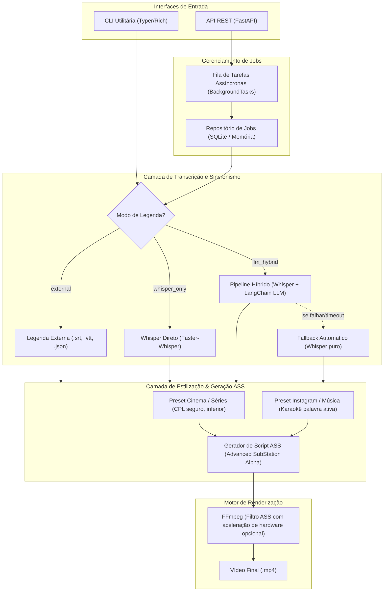

# Plano de Implementação: Serviço de Legendagem de Vídeos (.mp4)

Serviço modular em Python para transcrição, estilização e queima de legendas em vídeos `.mp4`, com foco em dois modos visuais principais:
1. **Cinema / Séries**: Estilo tradicional, discreto e otimizado para legibilidade (padrão Netflix/broadcast).
2. **Instagram / Música**: Estilo Reels/Stories com efeito de karaokê dinâmico (destaque palavra por palavra, cores vibrantes e quebras rítmicas de alto impacto).

---

## 1. Visão Geral da Arquitetura

O sistema adota uma arquitetura em camadas desacopladas:



---

## 2. Decisões Técnicas Alinhadas

| Componente | Tecnologia Escolhida | Justificativa |
| :--- | :--- | :--- |
| **Framework Web** | `FastAPI` + `Uvicorn` | Alto desempenho, suporte assíncrono nativo, OpenAPI docs automática e tipagem estrita com Pydantic v2. |
| **CLI Local** | `Typer` + `Rich` | Permite testes rápidos locais, scripts automatizados e interface com barras de progresso elegantes. |
| **Transcrição Base** | `faster-whisper` (CTranslate2) | Até 4x mais rápido que o Whisper original, menor consumo de VRAM/RAM e timestamps por palavra nativos (`word_timestamps=True`). |
| **Refinamento com LLM** | `LangChain` (`ChatOpenAI`) | Flexível e agnóstico: suporta **OpenCode Go** (`base_url` customizada) e **DeepSeek** (V3/R1) sem dependência de vendor lock-in. |
| **Resiliência LLM** | Fallback transparente | Se a LLM falhar (timeout, cota, erro de conexão), o sistema utiliza diretamente os timestamps do Whisper sem interromper o job. |
| **Motor de Renderização** | `FFmpeg` com filtro `ass` | Processamento via C altamente otimizado; evita o gargalo de bibliotecas frame-a-frame em Python (`MoviePy`/`OpenCV`) que seriam 10x a 50x mais lentas. |
| **Formato de Estilo** | `ASS` (Advanced SubStation Alpha) | Padrão da indústria para animações de texto, suporte a tags de karaokê (`\k`), cores hexadecimais BGR, rotações e outlines. |

---

## 3. Especificação dos Modos de Legenda

### A. Modo Cinema e Séries (`movie_series`)
* **Posicionamento**: Terço inferior centralizado (`Alignment = 2`).
* **Tipografia**: Fontes neutras e altamente legíveis (ex.: Roboto, Arial, Montserrat, Inter).
* **Padrão de Quebra**: Máximo de 37 a 42 caracteres por linha (CPL) e no máximo 2 linhas simultâneas.
* **Aspecto Visual**: Texto branco ou amarelo-clássico com contorno preto nítido de 2px e leve sombra para garantir legibilidade sobre qualquer fundo de cena.
* **Transição**: Exibição em bloco contínuo por sentença/fração de diálogo.

### B. Modo Instagram e Música (`instagram_music`)
* **Posicionamento**: Terço médio/centro da tela (`Alignment = 5` ou `2` com margem vertical elevada).
* **Tipografia**: Fontes pesadas de alto impacto (ex.: Impact, Montserrat Black, The Bold Font).
* **Padrão de Quebra**: Frases curtas e rítmicas de 2 a 5 palavras por vez na tela.
* **Efeito Karaokê (Palavra Ativa)**:
  * As palavras do bloco atual aparecem na tela;
  * À medida que o cantor/locutor fala, a **palavra ativa muda para a cor de destaque** (ex.: `#00FFCC` ciano, `#FFD700` amarelo ouro ou `#FF1493` rosa choque);
  * As palavras inativas permanecem em cor neutra (branco com leve transparência).
* **Customizações**: Override via API/CLI de cor ativa, cor inativa, tamanho da fonte e alinhamento vertical.

---

## 4. Estrutura do Projeto

```
c:\workspace\python\video-subtitleler/
├── pyproject.toml              # Dependências e empacotamento com Poetry/Pip
├── README.md                   # Documentação de instalação e uso
├── .env.example                # Configuração de variáveis de ambiente
├── src/
│   └── video_subtitleler/
│       ├── __init__.py
│       ├── config.py           # Configurações gerais (Pydantic Settings)
│       ├── models/
│       │   ├── __init__.py
│       │   ├── schema.py       # Pydantic Schemas (Job, SubtitleRequest, Presets)
│       │   └── subtitles.py    # Modelos de dados (Word, Segment, SubtitleTrack)
│       ├── services/
│       │   ├── __init__.py
│       │   ├── audio.py        # Extração e normalização de áudio via FFmpeg
│       │   ├── transcriber.py  # Wrapper Faster-Whisper
│       │   ├── llm_enhancer.py # LangChain pipeline (OpenCode Go / DeepSeek) com Fallback
│       │   ├── ass_builder.py  # Construtor de arquivos ASS (Cinema vs Instagram Karaoke)
│       │   └── renderer.py     # Queima de legendas com FFmpeg
│       ├── storage/
│       │   ├── __init__.py
│       │   └── job_store.py    # Repositório de estado de jobs (SQLite / Memória)
│       ├── api/
│       │   ├── __init__.py
│       │   ├── app.py          # Instância do FastAPI e middlewares
│       │   ├── routes.py       # Endpoints (/jobs, /upload, /status, /download)
│       │   └── dependencies.py # Injeção de dependências
│       └── cli/
│           ├── __init__.py
│           └── main.py         # Interface CLI via Typer
└── tests/
    ├── test_ass_builder.py     # Testes de geração de scripts ASS
    ├── test_llm_enhancer.py    # Testes do LangChain com mock e fallback
    ├── test_pipeline.py        # Testes de integração de ponta a ponta
    └── test_api.py             # Testes dos endpoints HTTP da FastAPI
```

---

## 5. Especificação da API REST (FastAPI)

### Endpoints Principais

1. **`POST /api/v1/subtitles/generate`** (Multipart/Form-Data)
   * **Parâmetros**:
     * `video_file`: Arquivo `.mp4`
     * `transcription_mode`: `"llm_hybrid"` | `"whisper_only"` | `"external"`
     * `style_preset`: `"movie_series"` | `"instagram_music"`
     * `external_subtitle_file`: Opcional (`.srt`, `.vtt`, `.json`) se o modo for `"external"`
     * `language`: Código ISO (ex: `"pt"`, `"en"` ou `"auto"`)
     * `custom_style`: JSON opcional para sobreposição de cores, fontes e tamanhos
   * **Resposta (202 Accepted)**:
     ```json
     {
       "job_id": "c7a8b8c2-3e4b-4a55-89f1-d52b1b3b2c1a",
       "status": "QUEUED",
       "created_at": "2026-10-24T14:10:00Z",
       "message": "Job aceito para processamento em background."
     }
     ```

2. **`GET /api/v1/jobs/{job_id}`**
   * **Resposta (200 OK)**:
     ```json
     {
       "job_id": "c7a8b8c2-3e4b-4a55-89f1-d52b1b3b2c1a",
       "status": "PROCESSING",
       "progress_pct": 65,
       "current_step": "burning_subtitles",
       "steps": {
         "extract_audio": "COMPLETED",
         "transcription": "COMPLETED",
         "llm_enhancement": "COMPLETED",
         "generate_ass": "COMPLETED",
         "burning_subtitles": "RUNNING"
       },
       "error": null
     }
     ```

3. **`GET /api/v1/jobs/{job_id}/download`**
   * Retorna o arquivo `.mp4` legendado pronto para streaming ou download via `FileResponse`.

---

## 6. Configuração do LangChain (OpenCode Go / DeepSeek)

```python
# Exemplo de configuração flexível no src/video_subtitleler/services/llm_enhancer.py
from langchain_openai import ChatOpenAI
from langchain_core.prompts import ChatPromptTemplate
from pydantic import BaseModel

class LLMEnhancer:
    def __init__(self, api_key: str, base_url: str = "https://api.opencode.ai/v1", model: str = "deepseek-chat"):
        self.llm = ChatOpenAI(
            api_key=api_key,
            base_url=base_url,
            model=model,
            temperature=0.2,
            timeout=30.0
        )
```

O prompt envia as palavras extraídas com seus timestamps brutos e instrui o modelo a:
1. Corrigir ortografia e pontuação sem alterar tempos de início e fim.
2. Agrupar em segmentos conforme o estilo:
   - Para `instagram_music`: agrupar de 2 a 4 palavras com alta musicalidade e ritmo.
   - Para `movie_series`: criar frases completas de até 40 caracteres por linha.
3. Se a chamada à LLM falhar (rede, quota, timeout), o método `enhance_with_fallback()` loga o aviso e devolve o alinhamento nativo do Whisper imediatamente.

---

## 7. Plano de Verificação

### Testes Automatizados
* **`tests/test_ass_builder.py`**:
  * Verifica se o arquivo `.ass` gerado contém os cabeçalhos corretos (`[V4+ Styles]` e `[Events]`).
  * Valida que o estilo `instagram_music` inclui as tags de tempo e destaque de palavras.
  * Valida que o estilo `movie_series` respeita as quebras de linha padrão.
* **`tests/test_llm_enhancer.py`**:
  * Testa o fluxo de enriquecimento com mock da API.
  * Testa o mecanismo de fallback quando a LLM gera exceção ou timeout.
* **`tests/test_api.py`**:
  * Testa o ciclo de vida dos jobs via TestClient do FastAPI.

### Verificação Manual
1. Gerar um vídeo curto de teste `.mp4` sintético via FFmpeg com áudio de voz.
2. Executar via CLI nos dois modos:
   - `python -m video_subtitleler.cli process video_teste.mp4 --style movie_series`
   - `python -m video_subtitleler.cli process video_teste.mp4 --style instagram_music`
3. Iniciar o servidor FastAPI (`uvicorn video_subtitleler.api.app:app`) e testar via Swagger UI (`/docs`).
4. Inspecionar o vídeo resultante em player para confirmar sincronismo e fidelidade visual.

---

## 8. Tarefas de implementação e sequência de commits

A execução deste plano foi decomposta em **12 tarefas atômicas**, ordenadas no [índice de tarefas](tasks/index.md). Cada tarefa prevê exatamente um commit com código, testes automatizados e documentação diretamente afetada no mesmo commit.

O índice contém dependências, mensagens Conventional Commit, decisões propostas para lacunas deste plano e gates externos. Os trechos das seções 1–7 permanecem como fonte literal de rastreabilidade. O progresso de execução e os resultados de validação estão registrados no índice de tarefas. A validação com provedores externos depende da configuração do ambiente de uso.
