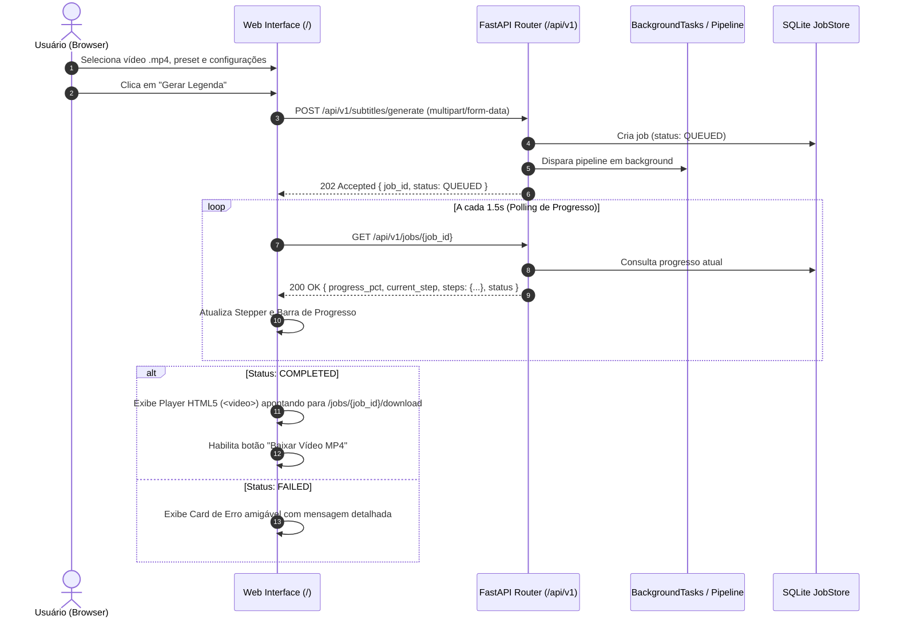

# Plano de Implementação: Interface Web para Video Subtitleler

Este plano detalha o design, arquitetura e implementação da interface web para consumir a API REST do `video-subtitleler`, alinhado com as decisões tomadas no processo de alinhamento com o usuário.

---

## Visão Geral e Objetivos

O `video-subtitleler` possui uma API FastAPI robusta (`/api/v1/subtitles/generate`, `/api/v1/jobs/{job_id}` e `/api/v1/jobs/{job_id}/download`) que realiza extração de áudio, transcrição Whisper, refinamento LLM opcional, geração ASS estilizada e queima de legenda com FFmpeg via tarefas em background.

Atualmente, o endpoint `/` apenas redireciona para o Swagger `/docs`.
O objetivo é fornecer uma **interface web moderna, intuitiva e responsiva**, servida diretamente pelo FastAPI na raiz `/`, sem exigir servidores Node.js/Vite ou dependências adicionais de build, permitindo:
1. Enviar vídeos MP4 (via arrastar e soltar ou seleção de arquivo) com validação visual imediata.
2. Selecionar o modo de transcrição (`whisper_only`, `llm_hybrid`, `external`).
3. Fazer upload de arquivo de legenda externa (`.srt`, `.vtt`, `.json`) condicionalmente quando o modo for `external`.
4. Escolher presets (`movie_series` ou `instagram_music`) e personalizar parâmetros avançados de estilo (`custom_style`: cores, fontes, alinhamento, margem vertical, opacidade inativa e caracteres por linha).
5. Acompanhar o progresso do processamento em tempo real com barra percentual e **stepper visual** de cada uma das 5 etapas do pipeline.
6. Assistir ao vídeo final legendado diretamente no navegador com player HTML5 integrado e baixar o arquivo `.mp4` com um clique.

---

## User Review Required

> [!NOTE]
> - A interface será empacotada diretamente dentro de `src/video_subtitleler/api/static/` e servida pelo FastAPI usando `starlette.staticfiles.StaticFiles`.
> - A raiz `/` passará a entregar a interface web. A documentação interativa Swagger continuará integralmente disponível em `/docs` e a especificação OpenAPI em `/openapi.json`.
> - Nenhuma dependência externa de build (Node/npm/bundler) será introduzida: utilizaremos Tailwind CSS via CDN e JavaScript modular/reativo (Vanilla + Alpine.js), garantindo portabilidade em qualquer ambiente Python.

---

## Arquitetura e Fluxo de Dados



---

## Componentes da Interface Web

### 1. Header & Identidade
- Identidade visual minimalista no tema escuro moderno (Dark Mode com Tailwind).
- Indicador do status da conexão com a API e link direto para a documentação técnica `/docs`.

### 2. Painel de Envio (Upload & Configuração)
- **Área de Drag & Drop de Vídeo**:
  - Aceita apenas `.mp4`.
  - Exibe prévia com nome do arquivo, tamanho formatado e ícone de vídeo.
  - Alerta imediato se o arquivo ultrapassar o limite (500 MB) ou tiver extensão incorreta.
- **Configurações Principais**:
  - **Modo de Transcrição**:
    - `whisper_only` ("Whisper Direto" - Padrão)
    - `llm_hybrid` ("Whisper + Refinamento LLM")
    - `external` ("Legenda Externa Pré-existente")
  - **Upload de Legenda Externa** (revelado dinamicamente apenas quando modo = `external`):
    - Aceita `.srt`, `.vtt` ou `.json`.
    - Dica contextual: caso preset seja Instagram, alerta que `.json` com palavras alinhadas é necessário para efeito karaokê.
  - **Preset de Estilo**:
    - `movie_series` ("Cinema & Séries" - Texto inferior branco com contorno preto).
    - `instagram_music` ("Instagram & Música" - Karaokê central dinâmico com palavra ativa destacada).
  - **Idioma do Áudio**:
    - Seletor rápido com `auto` (Detecção automática), `pt` (Português), `en` (Inglês), `es` (Espanhol) ou campo para código ISO customizado.

### 3. Painel Expansível de Estilo Avançado (`custom_style`)
Accordion colapsável contendo controles visuais:
- **Cor da Palavra Ativa (`active_color`)**: Seletor de cores nativo HTML (`<input type="color">`) + campo Hex (padrão `#00FFCC`).
- **Cor das Palavras Inativas (`inactive_color`)**: Seletor de cores + campo Hex (padrão `#FFFFFF`).
- **Opacidade Inativa (`inactive_opacity`)**: Slider interativo de `0.0` a `1.0` (padrão `0.85`).
- **Tamanho da Fonte (`font_size`)**: Slider e campo numérico de `8` a `200` pt (com presets sugeridos: 36, 48, 64).
- **Família da Fonte (`font_name`)**: Dropdown com fontes do sistema suportadas (`Arial`, `Impact`, `Trebuchet MS`, `Verdana`, etc.).
- **Alinhamento ASS (`alignment`)**: Seletor em grade 3x3 (1 a 9 correspondendo ao padrão numérico numpad do ASS).
- **Margem Vertical (`margin_vertical`)**: Slider e campo numérico de `0` a `4096` px.
- **Caracteres por Linha (`cpl`)**: Slider de `37` a `42` (padrão `40`).

### 4. Stepper de Progresso em Tempo Real
Quando o job é aceito, a tela transiciona suavemente para o painel de monitoramento:
- Barra de progresso geral animada (`0%` a `100%`).
- Stepper com as 5 etapas do `JobStep`:
  1. `extract_audio` - **Extração de Áudio** (FFprobe / FFmpeg WAV mono 16kHz)
  2. `transcription` - **Transcrição Whisper** (Faster-Whisper com timestamps)
  3. `llm_enhancement` - **Refinamento LLM** (Pontuação e formatação contextual)
  4. `generate_ass` - **Geração de Legenda ASS** (Estilização e posicionamento)
  5. `burning_subtitles` - **Renderização Final** (Gravação de legenda no MP4 com FFmpeg)
- Badges dinâmicos de status para cada etapa:
  - `PENDING` (Aguardando - Ícone de relógio cinza)
  - `RUNNING` (Processando - Spinner azul animado)
  - `COMPLETED` (Concluído - Check verde)
  - `SKIPPED` (Dispensado - Traço amarelo/cinza, ex: LLM desabilitada ou modo external)
  - `FAILED` (Falhou - Alerta vermelho)

### 5. Área de Resultado & Player
- Ao atingir `COMPLETED`:
  - Player de vídeo nativo HTML5 (`<video controls>`) com `src="/api/v1/jobs/{job_id}/download"`.
  - Botão de destaque **"Baixar Vídeo (.mp4)"**.
  - Botão secundário **"Processar Novo Vídeo"** (retorna ao formulário limpo).
- Se `FAILED`:
  - Box de erro em vermelho com o texto retornado pelo backend (`error`) e orientações para correção.

---

## Mudanças Propostas no Código

### Backend: FastAPI & Roteamento

#### [MODIFY] `src/video_subtitleler/api/app.py`
- Importar `StaticFiles` e montar a pasta `src/video_subtitleler/api/static` como estática.
- Alterar o endpoint `/` para servir `index.html` via `FileResponse` ou diretamente através da montagem `StaticFiles(html=True)`.
- Manter o redirecionamento ou link para `/docs`.

```python
# Trecho de exemplo em app.py
from pathlib import Path
from fastapi.staticfiles import StaticFiles
from fastapi.responses import FileResponse

STATIC_DIR = Path(__file__).resolve().parent / "static"

def create_app(settings: Settings | None = None, pipeline=None) -> FastAPI:
    application = FastAPI(title="Video Subtitleler", version="0.1.0")
    application.state.settings = settings
    application.state.pipeline = pipeline
    application.state.pipeline_lock = threading.Lock()
    application.include_router(router)

    if STATIC_DIR.is_dir():
        application.mount("/static", StaticFiles(directory=STATIC_DIR), name="static")

    @application.get("/", include_in_schema=False)
    def index():
        index_file = STATIC_DIR / "index.html"
        if index_file.is_file():
            return FileResponse(index_file)
        return RedirectResponse(url="/docs")

    return application
```

---

### Frontend: Assets Estáticos

#### [NEW] `src/video_subtitleler/api/static/index.html`
- Estrutura semântica HTML5.
- Importação do Tailwind CSS (CDN oficial) e Alpine.js (CDN oficial com integridade e fallback seguro).
- Componentes reativos vinculados ao estado da aplicação:
  - Card de Upload com Drag & Drop e preview.
  - Seletores de opções (Modo, Preset, Idioma).
  - Painel de Estilo Avançado colapsável.
  - Stepper visual e barra de progresso.
  - Player de vídeo e botões de ação final.

#### [NEW] `src/video_subtitleler/api/static/app.js`
- Lógica reativa com Alpine.js:
  - Gerenciamento de estado do formulário (`file`, `mode`, `preset`, `lang`, `externalSub`, `customStyle`).
  - Serialização adequada do `custom_style` como string JSON conforme exigido pela API (`custom_style: Annotated[str, Form()] = "{}"`).
  - Submissão via `fetch('/api/v1/subtitles/generate', { method: 'POST', body: formData })`.
  - Tratamento de códigos de retorno HTTP: 202 (sucesso aceito), 413 (tamanho excedido), 422 (parâmetros ou formatos inválidos).
  - Loop de polling resiliente com `setInterval` / `fetch('/api/v1/jobs/' + jobId)` a cada 1.5s com cancelamento automático quando `status` for `COMPLETED` ou `FAILED`.
  - Atualização do player de vídeo e exibição do botão de download.

#### [NEW] `src/video_subtitleler/api/static/style.css`
- Ajustes finos de animações (pulse no stepper, transições de opacidade e estilo de sliders de cores e ranges).

---

## Plano de Testes e Validação

### Testes Automatizados

#### [NEW] `tests/test_web_ui.py`
- Testar que a rota `GET /` retorna status 200 com `content-type: text/html`.
- Testar que os arquivos estáticos (`/static/app.js`, `/static/style.css`) são servidos com sucesso.
- Testar que a rota `/docs` continua respondendo 200 para a documentação Swagger da API.
- Executar a suíte de testes com pytest:
  ```powershell
  .\.venv\Scripts\python -m pytest tests/test_web_ui.py -v
  ```

### Testes Manuais de Integração
1. Iniciar a API:
   ```powershell
   .\.venv\Scripts\python -m uvicorn video_subtitleler.api.app:app --host 127.0.0.1 --port 8000
   ```
2. Acessar `http://127.0.0.1:8000/` no navegador.
3. Testar a submissão de um vídeo com o preset Cinema (`movie_series`).
4. Observar o stepper avançando pelas etapas (`extract_audio`, `transcription`, `generate_ass`, `burning_subtitles`).
5. Confirmar reprodução no player de vídeo integrado e efetuar o download do MP4.
6. Testar com legenda externa (`.srt` / `.json`) e preset Instagram (`instagram_music`).
7. Testar comportamento com arquivo inválido para validar exibição amigável do erro 422.
