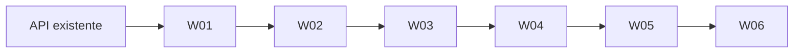

# Tarefas atômicas — Interface web

Plano de origem: [IMPLEMENTATION_PLAN.md](../IMPLEMENTATION_PLAN.md). Referência externa preservada: [web_interface_plan.md](../reference/web_interface_plan.md). Criado em 26/10/2026.

## Regra de atomicidade

Seis tarefas correspondem a seis commits de implementação. Cada commit inclui produção, testes desse comportamento, documentação afetada e progresso; nenhum commit futuro somente de testes corrige a falta de cobertura de código anterior. Este índice não executa implementação nem cria commits ou chats.

## Contexto e convenções

- Instruções AGENTS da sessão continuam aplicáveis. Não foi encontrado AGENTS.md no repositório nem nos dois diretórios ancestrais inspecionados. LibreOffice não é necessário para estes documentos Markdown.
- Base verificada: FastAPI/TestClient, pytest por funções, setuptools com layout src, API multipart e pipeline síncrono em BackgroundTasks. Há mudanças anteriores não commitadas: preservá-las e selecionar arquivos/hunks explicitamente.
- Arquivos existentes e criações propostas estão separados na seção 9 do plano. `tests/web`, extra `web-test`, marcador `web_ui` e lock são propostas introduzidas em W01, não recursos já disponíveis.
- Frontend CSS/JS local é adaptação explícita da referência que propunha Tailwind/Alpine via CDN. Não instalar Node/bundler. Tooling de navegador fica em Python, separado do runtime.
- Testes devem isolar Settings do .env pessoal, iniciar porta temporária e encerrar o servidor. Nada de chamadas LLM/pesos/download de browser dentro da suíte padrão.
- Atualizar README, registro de validação, tarefa e este índice junto de cada comportamento. Evidências de testes e gates devem indicar execução real versus mocks.

## Ordem de execução

| Ordem | Tarefa | Dependência | Conventional Commit | Status | Critérios |
|---|---|---|---|---|---|
| 1 | [W01 — Servir a interface local e a configuração pública](w01-pagina-assets-configuracao.md) | — | `feat(web): serve local interface assets and public upload config` | Concluída | 6/6 |
| 2 | [W02 — Enviar MP4 e concluir o primeiro ciclo pelo navegador](w02-envio-ciclo-inicial.md) | W01 | `feat(web): submit videos and track subtitle jobs` | Concluída | 6/6 |
| 3 | [W03 — Processar legendas externas com regras condicionais](w03-legendas-externas.md) | W02 | `feat(web): support external subtitle uploads` | Concluída | 6/6 |
| 4 | [W04 — Personalizar estilo preservando valores automáticos](w04-estilo-avancado.md) | W03 | `feat(web): add validated subtitle style controls` | Concluída | 6/6 |
| 5 | [W05 — Mostrar etapas e recuperar o acompanhamento interrompido](w05-progresso-resiliente.md) | W04 | `feat(web): show pipeline steps and recover job polling` | Não iniciada | 0/6 |
| 6 | [W06 — Reproduzir o resultado e iniciar outro vídeo com estado limpo](w06-resultado-player-novo-video.md) | W05 | `feat(web): preview subtitle results and reset the workflow` | Não iniciada | 0/6 |

## Cadeia de dependências



A sequência conservadora permite estender os mesmos assets sem conflitos. Todas as dependências são anteriores; não implica autorização para delegar ou abrir novos chats.

## Cobertura e propriedade

W01 entrega página/empacotamento/configuração e shell testado; W02 entrega ciclo mínimo completo com testes; W03 amplia external; W04 amplia estilo; W05 amplia etapas/recuperação; W06 amplia resultado/player/reset. Cada tarefa mantém o predecessor operável. Criação inicial dos arquivos e extensões: seção 9 do plano. Testes de composição de W06 não substituem cobertura de W01–W05.

## Gates externos e limites

- Preparação durante W01: ferramentas Python de teste, browser Chromium e rede para instalar; registrar versões compatíveis no lock. Durante runtime, assets locais não dependem de CDN.
- HTTP local permitido para TestClient/servidor/browser; testes isolados não encerram o serviço pessoal na porta 8000.
- FFmpeg/FFprobe e codecs/fonte para mídia real; fixtures sintéticas temporárias não dependem da pasta output existente.
- Reprodução H.264/AAC em Chrome/Edge Windows e inspeção visual responsiva exigem evidência própria. Browser sem codec é pendência, não aprovação.
- Voz autorizada, pesos locais e LLM são gates separados quando testados de verdade. Nunca enviar chave ao browser, serializar Settings ou consumir assinatura em testes automáticos comuns.
- Fora do escopo: autenticação, publicação, editor, histórico, tradução, cancelamento remoto, retomada persistente e workers distribuídos.

## Validação documental

```powershell
.\.venv\Scripts\python scripts/verify_plan_excerpts.py docs/web-interface/tasks
```

Verificar também links relativos, seis arquivos de tarefa, seis critérios por arquivo (36), ordem sem dependência futura, mensagens de commit únicas e correspondência com o plano. A referência externa foi copiada, não reescrita; não há sequência antiga de commits nela a corrigir.

## Progresso agregado

| Métrica | Valor |
|---|---|
| Tarefas | 6 |
| Não iniciadas | 2 |
| Em andamento | 0 |
| Concluídas | 4 |
| Critérios concluídos | 24/36 |
| Progresso por critérios | 66,7% |

Validação documental não significa implementação concluída. Nenhum teste de produção foi executado nesta decomposição; resultados futuros pertencem a `docs/web-interface/validation.md` quando criado em W01.
