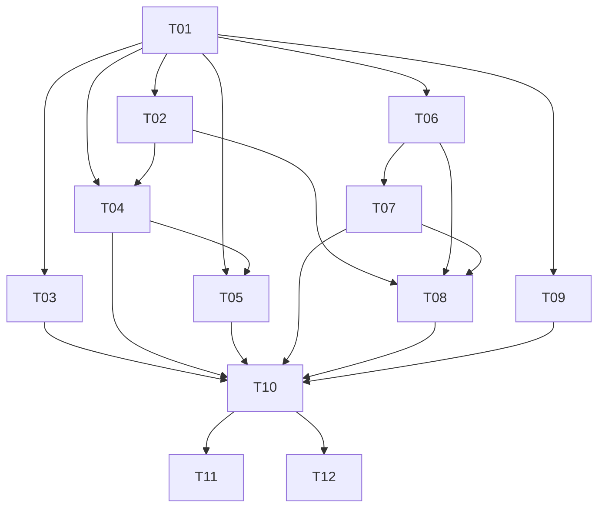

# Tarefas atômicas — serviço de legendagem

Plano de origem: [IMPLEMENTATION_PLAN.md](../IMPLEMENTATION_PLAN.md). Decomposição criada em 24/10/2026.

## Regra de atomicidade

Cada uma das **12 tarefas corresponde a um commit**, incluindo código, testes automatizados do comportamento, documentação afetada e atualização de progresso. Nenhum commit de produção depende de testes adicionados apenas depois. Os testes extras da integração validam a composição; não substituem testes dos componentes. Este índice não cria chats nem executa a implementação.

## Contexto e convenções

- Inspeção inicial: somente IMPLEMENTATION_PLAN.md existia, inclusive considerando arquivos ocultos. Não havia AGENTS.md local, testes, build, documentação adicional ou diretório .git; `git status` indicou que a pasta não é um repositório Git. Não há alterações preexistentes de código a preservar.
- As instruções AGENTS fornecidas na sessão continuam aplicáveis: se alguma conversão de documentos for necessária, verificar o LibreOffice nativo em `C:\Program Files\LibreOffice`, com perfil temporário isolado. Esta decomposição não requer conversão.
- Caminhos de código/testes listados são propostas de criação ou extensões de predecessores; não são apresentados como arquivos existentes. Os arquivos `services/external_subtitles.py`, `services/pipeline.py` e `cli/__main__.py` complementam a árvore ilustrativa do plano para torná-lo executável.
- Convenções propostas: pacote src, pytest com funções de teste e Conventional Commits. T01 define instalação e registro do marcador `integration_whisper`; testes de FFmpeg fazem skip explícito se o recurso faltar. Nenhum teste padrão deve depender de credenciais, rede ou download automático de pesos.
- O histórico Git local foi inicializado durante a execução de ponta a ponta autorizada. Cada tarefa registra código, testes e documentação no commit previsto; nenhuma publicação remota foi feita. Documentação não está ignorada.

## Ordem de execução

| Ordem | Tarefa | Dependências | Conventional Commit | Status |
|---|---|---|---|---|
| 1 | [T01 — Criar pacote, contratos e configuração validada](t01-base-contratos-configuracao.md) | — | `feat(core): define subtitle contracts and settings` | Concluída |
| 2 | [T02 — Extrair áudio normalizado com FFmpeg](t02-extracao-audio.md) | T01 | `feat(audio): extract normalized audio from mp4` | Concluída |
| 3 | [T03 — Importar legendas SRT, VTT e JSON](t03-legendas-externas.md) | T01 | `feat(subtitles): import external subtitle tracks` | Concluída |
| 4 | [T04 — Transcrever com Faster-Whisper e tempos por palavra](t04-transcricao-whisper.md) | T01, T02 | `feat(transcription): add faster whisper adapter` | Concluída |
| 5 | [T05 — Refinar texto com LLM e preservar fallback temporal](t05-refinamento-llm-fallback.md) | T01, T04 | `feat(llm): refine subtitles with timestamp safe fallback` | Concluída |
| 6 | [T06 — Gerar ASS legível para cinema e séries](t06-ass-cinema.md) | T01 | `feat(ass): generate movie and series subtitles` | Concluída |
| 7 | [T07 — Adicionar karaokê com destaque exclusivo da palavra ativa](t07-ass-karaoke.md) | T06 | `feat(ass): highlight active words in karaoke subtitles` | Concluída |
| 8 | [T08 — Queimar ASS em MP4 e validar a saída](t08-renderizacao-ffmpeg.md) | T02, T06, T07 | `feat(render): burn ass subtitles into mp4` | Concluída |
| 9 | [T09 — Persistir estado e progresso de jobs](t09-repositorio-jobs.md) | T01 | `feat(jobs): persist job lifecycle in sqlite` | Concluída |
| 10 | [T10 — Orquestrar os três modos com progresso e isolamento](t10-pipeline-integrado.md) | T03, T04, T05, T07, T08, T09 | `feat(pipeline): orchestrate subtitle generation modes` | Concluída |
| 11 | [T11 — Expor processamento local pela CLI](t11-cli.md) | T10 | `feat(cli): expose subtitle processing commands` | Concluída |
| 12 | [T12 — Expor geração assíncrona, consulta e download pela API](t12-api-background-download.md) | T10 | `feat(api): expose background subtitle jobs and downloads` | Não iniciada |

## Cadeia de dependências



A tabela é uma ordenação topológica válida. T11 e T12 consomem o mesmo pipeline e podem ser entregues independentemente depois de T10; a sequência sugerida segue a tabela.

## Cobertura e decisões explícitas

| Conteúdo do plano | Tarefa proprietária |
|---|---|
| Tecnologia, empacotamento, configuração e contratos (seções 2/4) | T01 |
| Áudio FFmpeg (seções 1/4) | T02 |
| Importação external SRT/VTT/JSON (seções 1/5) | T03 |
| Faster-Whisper e tempos por palavra (seções 1/2/4) | T04 |
| LangChain, provedor configurável e fallback (seções 2/6/7) | T05 |
| ASS comum e movie_series (seções 3A/7) | T06 |
| instagram_music, palavra ativa e overrides (seções 3B/6/7) | T07 |
| Renderização MP4 e aceleração opcional (seções 1/2/4) | T08 |
| Repositório de jobs e estados (seções 1/4/5) | T09 |
| Roteamento, composição e integração de ponta a ponta (seções 1/7) | T10 |
| CLI Typer/Rich e comandos manuais (seções 2/4/7) | T11 |
| BackgroundTasks, multipart, consulta, download e Swagger (seções 1/5/7) | T12 |

Cada arquivo de produção tem uma tarefa de criação proprietária. T07 estende ASS criado em T06; T11/T12 só acrescentam seu empacotamento ao pyproject de T01. Testes e documentação são atualizados junto com cada extensão.

Escolhas para lacunas do plano: Python 3.12 e instalação pip em T01; CPL padrão 40 (faixa 37–42); grupos determinísticos de 2–5 palavras e LLM de 2–4, com bloco residual menor; JSON compatível com SubtitleTrack; rejeição de karaokê externo sem palavras alinhadas; SQLite principal; whisper_only padrão da CLI; códigos HTTP complementares em T12. Todas estão identificadas como escolhas, sem alterar os trechos literais. A correção LLM não pode criar tempos novos. Destaque deve ser exclusivo da palavra ativa, mesmo se tags ASS acumulativas exigirem outra construção.

## Gates externos e limites

- Git local inicializado; commits registrados sem repositório remoto.
- Ambiente isolado Windows/Python 3.12.6 instalado com todos os extras e sem conflitos; versões em `requirements-dev.lock`. FFmpeg com libass validado em CPU.
- FFmpeg/FFprobe com libass e fontes instaladas são necessários às integrações e inspeção visual. Aceleração por hardware é opcional e exige teste no equipamento.
- Whisper real depende de pesos e áudio de voz autorizado. Um vídeo com tom sintético valida o caminho de mídia, mas não comprova transcrição ou sincronismo de fala.
- OpenCode Go/DeepSeek dependem de endpoint, modelo, credenciais e resposta compatíveis confirmados; mocks cobrem contrato/fallback, não comprovam suporte real do provedor. Chaves ficam fora dos arquivos versionados.
- Revisão manual final: executar os comandos CLI dos dois presets na seção 7 com voz, conferir o MP4 em player e testar /docs do servidor. Registrar ausência de recursos como pendência, sem marcar aprovação fictícia.
- Não acrescentar tradução, diarização, alinhamento forçado, autenticação, publicação, fila distribuída ou retomada automática. BackgroundTasks + SQLite não garantem processamento durável após reinício.

## Validação da decomposição

```powershell
python scripts/verify_plan_excerpts.py tasks
```

O verificador foi copiado integralmente da skill indicada pelo usuário para tornar a checagem reproduzível. Além dos trechos literais, conferir links relativos, 12 tarefas na tabela, dependências anteriores, 6 critérios por tarefa (72 no total) e consistência com a seção 8 do plano.

## Progresso agregado

| Métrica | Valor |
|---|---|
| Tarefas | 12 |
| Não iniciadas | 1 |
| Em andamento | 0 |
| Concluídas | 11 |
| Critérios concluídos | 66/72 |
| Progresso por critérios | 92% |

Cada snapshot foi validado isoladamente antes do commit. A suíte completa no ambiente de entrega teve **146 testes aprovados**, sem skips, incluindo Whisper tiny local e voz sintética. FFmpeg real, os dois presets, CLI e servidor Uvicorn com download foram exercitados. Evidências de validação serão registradas junto com T12.

Gates remanescentes: revisão humana em player, credenciais/compatibilidade com provedor LLM externo e hardware opcional. Estes não foram simulados como provas reais. O cliente LangChain foi testado com servidor compatível local.
