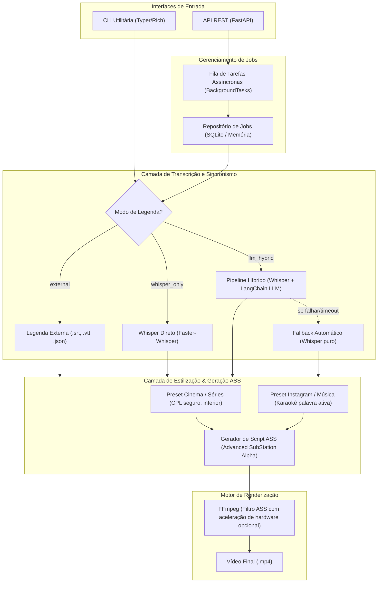

# T02 — Extrair áudio normalizado com FFmpeg

> **Instruções do projeto:** consultar [contexto e convenções](index.md#contexto-e-convenções) e preservar as instruções AGENTS fornecidas na sessão.

> **Status:** Concluída; gates externos documentados
> **Progresso:** 100%
> **Início:** 24/10/2026 | **Fim previsto:** - | **Fim real:** 24/10/2026
> **Responsável:** Codex
> **Dependências:** [T01](t01-base-contratos-configuracao.md)
> **Commit único:** `feat(audio): extract normalized audio from mp4`

## 1. Por que

Entregar extração de áudio utilizável e testável isoladamente, com tratamento de falhas antes da transcrição.

## 2. Referencia exata no plano

Plano: [IMPLEMENTATION_PLAN.md](../IMPLEMENTATION_PLAN.md)

Trechos literais; escolhas e complementos de implementação aparecem fora dos marcadores.

<!-- PLAN_EXCERPT_START -->
````text
## 1. Visão Geral da Arquitetura

O sistema adota uma arquitetura em camadas desacopladas:



---
````
<!-- PLAN_EXCERPT_END -->

<!-- PLAN_EXCERPT_START -->
````text
## 4. Estrutura do Projeto

```
c:\workspace\python\video-subtitleler/
├── pyproject.toml              # Dependências e empacotamento com Poetry/Pip
├── README.md                   # Documentação de instalação e uso
├── .env.example                # Configuração de variáveis de ambiente
├── src/
│   └── video_subtitleler/
│       ├── __init__.py
│       ├── config.py           # Configurações gerais (Pydantic Settings)
│       ├── models/
│       │   ├── __init__.py
│       │   ├── schema.py       # Pydantic Schemas (Job, SubtitleRequest, Presets)
│       │   └── subtitles.py    # Modelos de dados (Word, Segment, SubtitleTrack)
│       ├── services/
│       │   ├── __init__.py
│       │   ├── audio.py        # Extração e normalização de áudio via FFmpeg
│       │   ├── transcriber.py  # Wrapper Faster-Whisper
│       │   ├── llm_enhancer.py # LangChain pipeline (OpenCode Go / DeepSeek) com Fallback
│       │   ├── ass_builder.py  # Construtor de arquivos ASS (Cinema vs Instagram Karaoke)
│       │   └── renderer.py     # Queima de legendas com FFmpeg
│       ├── storage/
│       │   ├── __init__.py
│       │   └── job_store.py    # Repositório de estado de jobs (SQLite / Memória)
│       ├── api/
│       │   ├── __init__.py
│       │   ├── app.py          # Instância do FastAPI e middlewares
│       │   ├── routes.py       # Endpoints (/jobs, /upload, /status, /download)
│       │   └── dependencies.py # Injeção de dependências
│       └── cli/
│           ├── __init__.py
│           └── main.py         # Interface CLI via Typer
└── tests/
    ├── test_ass_builder.py     # Testes de geração de scripts ASS
    ├── test_llm_enhancer.py    # Testes do LangChain com mock e fallback
    ├── test_pipeline.py        # Testes de integração de ponta a ponta
    └── test_api.py             # Testes dos endpoints HTTP da FastAPI
```

---
````
<!-- PLAN_EXCERPT_END -->

## 3. Onde implementar

Caminhos relativos à raiz. Todos os arquivos de produção/teste abaixo são criações propostas ou extensões de tarefas predecessoras, pois ainda não existem no repositório. Nomes de testes são módulos pytest propostos, não classes existentes verificadas.

| Tipo | Arquivo | Ação |
|---|---|---|
| Produção | src/video_subtitleler/services/__init__.py; src/video_subtitleler/services/audio.py | Criar pacote e extração |
| Teste | tests/test_audio.py | Criar testes de subprocesso e integração |
| Documentação | README.md | Documentar FFmpeg/FFprobe e formato de áudio |

Atualizar o status desta tarefa e o [índice](index.md) no mesmo commit de entrega.

## 4. Como implementar

1. Validar entrada MP4 existente e usar FFprobe para detectar duração, dimensões e faixa de áudio. Definir erros de domínio claros para arquivo ilegível ou sem áudio.
2. Extrair WAV PCM mono a 16 kHz como escolha compatível com o transcritor. Usar lista de argumentos de subprocesso, sem shell, timeout configurável e diretório exclusivo do chamador.
3. Resolver executáveis pelo caminho configurado ou PATH; preservar entrada e remover somente saídas parciais criadas pela operação. Retornar metadados necessários ao render e à orquestração.

Manter o pacote importável e os predecessores funcionando ao concluir. A reversão deste commit deve preservar os predecessores; reverter consumidores posteriores primeiro, se já existirem.

## 5. Testes no mesmo commit

- Simular subprocessos para conferir argumentos, caminhos com espaços/acentos, timeout e diagnóstico de executável ausente.
- Executar integração com MP4 curto gerado por FFmpeg e conferir amostragem/canais com FFprobe.
- Cobrir arquivo ausente, mídia inválida, sem áudio e saída parcial; não tratar tom sintético como prova de reconhecimento de fala.

Código e testes são inseparáveis nesta tarefa. Testes unitários usam doubles nos limites externos; integrações reais são identificadas e relatadas separadamente, com skips explícitos quando seus recursos não existirem.

## 6. Validação

Executar da raiz após instalar o projeto com `python -m pip install -e ".[dev]"` (a instalação é entregue em T01):

```powershell
python -m pytest tests/test_audio.py
python -m pytest tests/test_models.py tests/test_config.py
python scripts/verify_plan_excerpts.py tasks
```

Relatar comandos executados, resultados e gates pendentes. Servidor manual não conta como teste automatizado aprovado.

## 7. Gates e fora do escopo

- Integração exige FFmpeg e FFprobe disponíveis. Na ausência, marcar explicitamente como skip e não declarar integração aprovada.
- Fora do escopo: transcrição, queima e gerenciamento de jobs.
- Implementar apenas o comportamento desta tarefa; não antecipar consumidores das tarefas seguintes.
- A documentação de tarefas não comprova implementação ou execução dos testes de produção.

## 8. Critérios de aceite (DoD)

- [x] Comportamento de produção descrito implementado e importável.
- [x] Testes automatizados desta tarefa entregues no mesmo commit e aprovados; skips/gates relatados.
- [x] Documentação diretamente afetada atualizada.
- [x] Trechos literais validados por `scripts/verify_plan_excerpts.py`.
- [x] Dependências, limites de escopo e regressões dos predecessores conferidos.
- [x] Um único commit criado com a mensagem prevista, com status desta tarefa e índice atualizados.

---
## Status de implementação da tarefa

| Item | Status |
|---|---|
| Implementação | Concluída |
| Testes | Automatizados aprovados; gates relatados |
| Documentação de implementação | README e contratos atualizados |
| Validação do usuário | Pendente |

**Progresso geral:** 100%

## Registro de execução — 24/10/2026

Implementação e testes entregues no mesmo commit previsto. O snapshot isolado deste commit foi validado com `python -m pytest -q tests/test_audio.py` antes do registro. Referências literais e links permanecem válidos.

FFmpeg/FFprobe reais validaram WAV mono PCM de 16 kHz. Rotação de exibição, ausência de áudio, timeout, executável ausente e limpeza foram cobertos.

Validação humana em player e uso com provedor LLM externo continuam pendentes conforme os gates do índice; não foram apresentados como aprovação automática.

