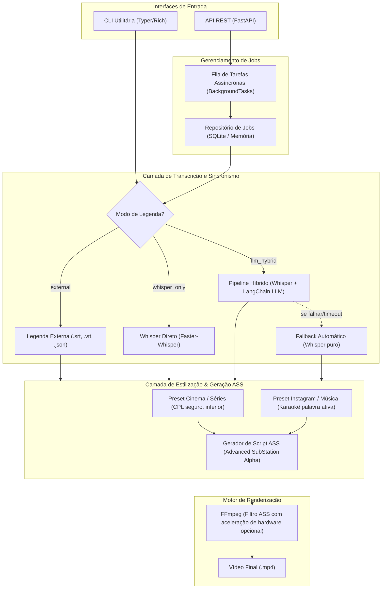

# T09 — Persistir estado e progresso de jobs

> **Instruções do projeto:** consultar [contexto e convenções](index.md#contexto-e-convenções) e preservar as instruções AGENTS fornecidas na sessão.

> **Status:** Concluída; gates externos documentados
> **Progresso:** 100%
> **Início:** 24/10/2026 | **Fim previsto:** - | **Fim real:** 24/10/2026
> **Responsável:** Codex
> **Dependências:** [T01](t01-base-contratos-configuracao.md)
> **Commit único:** `feat(jobs): persist job lifecycle in sqlite`

## 1. Por que

Oferecer repositório independente para o ciclo de vida de jobs antes da orquestração e da API.

## 2. Referencia exata no plano

Plano: [IMPLEMENTATION_PLAN.md](../IMPLEMENTATION_PLAN.md)

Trechos literais; escolhas e complementos de implementação aparecem fora dos marcadores.

<!-- PLAN_EXCERPT_START -->
````text
## 1. Visão Geral da Arquitetura

O sistema adota uma arquitetura em camadas desacopladas:



---
````
<!-- PLAN_EXCERPT_END -->

<!-- PLAN_EXCERPT_START -->
````text
## 5. Especificação da API REST (FastAPI)

### Endpoints Principais

1. **`POST /api/v1/subtitles/generate`** (Multipart/Form-Data)
   * **Parâmetros**:
     * `video_file`: Arquivo `.mp4`
     * `transcription_mode`: `"llm_hybrid"` | `"whisper_only"` | `"external"`
     * `style_preset`: `"movie_series"` | `"instagram_music"`
     * `external_subtitle_file`: Opcional (`.srt`, `.vtt`, `.json`) se o modo for `"external"`
     * `language`: Código ISO (ex: `"pt"`, `"en"` ou `"auto"`)
     * `custom_style`: JSON opcional para sobreposição de cores, fontes e tamanhos
   * **Resposta (202 Accepted)**:
     ```json
     {
       "job_id": "c7a8b8c2-3e4b-4a55-89f1-d52b1b3b2c1a",
       "status": "QUEUED",
       "created_at": "2026-10-24T14:10:00Z",
       "message": "Job aceito para processamento em background."
     }
     ```

2. **`GET /api/v1/jobs/{job_id}`**
   * **Resposta (200 OK)**:
     ```json
     {
       "job_id": "c7a8b8c2-3e4b-4a55-89f1-d52b1b3b2c1a",
       "status": "PROCESSING",
       "progress_pct": 65,
       "current_step": "burning_subtitles",
       "steps": {
         "extract_audio": "COMPLETED",
         "transcription": "COMPLETED",
         "llm_enhancement": "COMPLETED",
         "generate_ass": "COMPLETED",
         "burning_subtitles": "RUNNING"
       },
       "error": null
     }
     ```

3. **`GET /api/v1/jobs/{job_id}/download`**
   * Retorna o arquivo `.mp4` legendado pronto para streaming ou download via `FileResponse`.

---
````
<!-- PLAN_EXCERPT_END -->

## 3. Onde implementar

Caminhos relativos à raiz. Todos os arquivos de produção/teste abaixo são criações propostas ou extensões de tarefas predecessoras, pois ainda não existem no repositório. Nomes de testes são módulos pytest propostos, não classes existentes verificadas.

| Tipo | Arquivo | Ação |
|---|---|---|
| Produção | src/video_subtitleler/storage/__init__.py; src/video_subtitleler/storage/job_store.py | Criar contrato e implementações SQLite/memória |
| Teste | tests/test_job_store.py | Criar testes de persistência e transições |
| Documentação | README.md | Documentar estados, persistência e limitações |

Atualizar o status desta tarefa e o [índice](index.md) no mesmo commit de entrega.

## 4. Como implementar

1. Criar interface para criar, consultar e atualizar job; implementar SQLite como padrão escolhido e memória para testes/uso efêmero.
2. Persistir UUID, created_at em UTC, estado, progresso de 0–100, etapas, erro e caminho de saída interno. Reusar contratos de T01; não expor caminhos internos em respostas públicas.
3. Definir transições QUEUED → PROCESSING → COMPLETED/FAILED, atomicidade e comportamento de job inexistente. Etapas não aplicáveis devem ter representação explícita documentada.
4. Usar transações/conexões adequadas ao acesso em background e testar consultas concorrentes. Documentar que persistir estado não torna BackgroundTasks uma fila durável; jobs interrompidos não reiniciam automaticamente.

Manter o pacote importável e os predecessores funcionando ao concluir. A reversão deste commit deve preservar os predecessores; reverter consumidores posteriores primeiro, se já existirem.

## 5. Testes no mesmo commit

- Criar, consultar, atualizar e reabrir banco temporário, preservando todos os campos.
- Cobrir UUID ausente, transição inválida, progresso fora de faixa e falha de escrita.
- Executar mesmo contrato em memória e SQLite e testar atualizações/leituras concorrentes sem perder estado final.

Código e testes são inseparáveis nesta tarefa. Testes unitários usam doubles nos limites externos; integrações reais são identificadas e relatadas separadamente, com skips explícitos quando seus recursos não existirem.

## 6. Validação

Executar da raiz após instalar o projeto com `python -m pip install -e ".[dev]"` (a instalação é entregue em T01):

```powershell
python -m pytest tests/test_job_store.py
python -m pytest tests/test_models.py
python scripts/verify_plan_excerpts.py tasks
```

Relatar comandos executados, resultados e gates pendentes. Servidor manual não conta como teste automatizado aprovado.

## 7. Gates e fora do escopo

- SQLite/memória é uma alternativa aberta no plano; a escolha principal está declarada nesta decomposição.
- Fora do escopo: fila distribuída, recuperação automática após reinício e múltiplos workers coordenados.
- Implementar apenas o comportamento desta tarefa; não antecipar consumidores das tarefas seguintes.
- A documentação de tarefas não comprova implementação ou execução dos testes de produção.

## 8. Critérios de aceite (DoD)

- [x] Comportamento de produção descrito implementado e importável.
- [x] Testes automatizados desta tarefa entregues no mesmo commit e aprovados; skips/gates relatados.
- [x] Documentação diretamente afetada atualizada.
- [x] Trechos literais validados por `scripts/verify_plan_excerpts.py`.
- [x] Dependências, limites de escopo e regressões dos predecessores conferidos.
- [x] Um único commit criado com a mensagem prevista, com status desta tarefa e índice atualizados.

---
## Status de implementação da tarefa

| Item | Status |
|---|---|
| Implementação | Concluída |
| Testes | Automatizados aprovados; gates relatados |
| Documentação de implementação | README e contratos atualizados |
| Validação do usuário | Pendente |

**Progresso geral:** 100%

## Registro de execução — 24/10/2026

Implementação e testes entregues no mesmo commit previsto. O snapshot isolado deste commit foi validado com `python -m pytest -q tests/test_job_store.py` antes do registro. Referências literais e links permanecem válidos.

Contrato executado em memória e SQLite, com concorrência em jobs distintos e reabertura do banco. Conexões SQLite são fechadas explicitamente. Sem promessa de recuperação de jobs após reinício.

Validação humana em player e uso com provedor LLM externo continuam pendentes conforme os gates do índice; não foram apresentados como aprovação automática.

