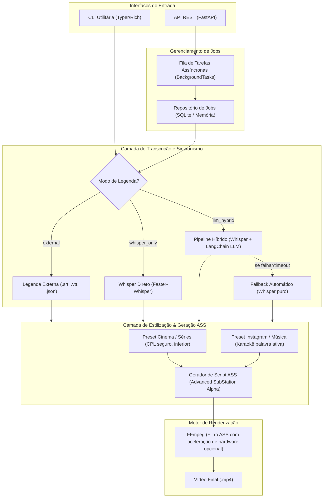

# T10 — Orquestrar os três modos com progresso e isolamento

> **Instruções do projeto:** consultar [contexto e convenções](index.md#contexto-e-convenções) e preservar as instruções AGENTS fornecidas na sessão.

> **Status:** Concluída; gates externos documentados
> **Progresso:** 100%
> **Início:** 24/10/2026 | **Fim previsto:** - | **Fim real:** 24/10/2026
> **Responsável:** Codex
> **Dependências:** [T03](t03-legendas-externas.md), [T04](t04-transcricao-whisper.md), [T05](t05-refinamento-llm-fallback.md), [T07](t07-ass-karaoke.md), [T08](t08-renderizacao-ffmpeg.md), [T09](t09-repositorio-jobs.md)
> **Commit único:** `feat(pipeline): orchestrate subtitle generation modes`

## 1. Por que

Conectar serviços já testados em uma operação completa compartilhável pela CLI e API, sem duplicar regras de negócio.

## 2. Referencia exata no plano

Plano: [IMPLEMENTATION_PLAN.md](../IMPLEMENTATION_PLAN.md)

Trechos literais; escolhas e complementos de implementação aparecem fora dos marcadores.

<!-- PLAN_EXCERPT_START -->
````text
## 1. Visão Geral da Arquitetura

O sistema adota uma arquitetura em camadas desacopladas:



---
````
<!-- PLAN_EXCERPT_END -->

<!-- PLAN_EXCERPT_START -->
````text
## 5. Especificação da API REST (FastAPI)

### Endpoints Principais

1. **`POST /api/v1/subtitles/generate`** (Multipart/Form-Data)
   * **Parâmetros**:
     * `video_file`: Arquivo `.mp4`
     * `transcription_mode`: `"llm_hybrid"` | `"whisper_only"` | `"external"`
     * `style_preset`: `"movie_series"` | `"instagram_music"`
     * `external_subtitle_file`: Opcional (`.srt`, `.vtt`, `.json`) se o modo for `"external"`
     * `language`: Código ISO (ex: `"pt"`, `"en"` ou `"auto"`)
     * `custom_style`: JSON opcional para sobreposição de cores, fontes e tamanhos
   * **Resposta (202 Accepted)**:
     ```json
     {
       "job_id": "c7a8b8c2-3e4b-4a55-89f1-d52b1b3b2c1a",
       "status": "QUEUED",
       "created_at": "2026-10-24T14:10:00Z",
       "message": "Job aceito para processamento em background."
     }
     ```

2. **`GET /api/v1/jobs/{job_id}`**
   * **Resposta (200 OK)**:
     ```json
     {
       "job_id": "c7a8b8c2-3e4b-4a55-89f1-d52b1b3b2c1a",
       "status": "PROCESSING",
       "progress_pct": 65,
       "current_step": "burning_subtitles",
       "steps": {
         "extract_audio": "COMPLETED",
         "transcription": "COMPLETED",
         "llm_enhancement": "COMPLETED",
         "generate_ass": "COMPLETED",
         "burning_subtitles": "RUNNING"
       },
       "error": null
     }
     ```

3. **`GET /api/v1/jobs/{job_id}/download`**
   * Retorna o arquivo `.mp4` legendado pronto para streaming ou download via `FileResponse`.

---
````
<!-- PLAN_EXCERPT_END -->

<!-- PLAN_EXCERPT_START -->
````text
## 7. Plano de Verificação

### Testes Automatizados
* **`tests/test_ass_builder.py`**:
  * Verifica se o arquivo `.ass` gerado contém os cabeçalhos corretos (`[V4+ Styles]` e `[Events]`).
  * Valida que o estilo `instagram_music` inclui as tags de tempo e destaque de palavras.
  * Valida que o estilo `movie_series` respeita as quebras de linha padrão.
* **`tests/test_llm_enhancer.py`**:
  * Testa o fluxo de enriquecimento com mock da API.
  * Testa o mecanismo de fallback quando a LLM gera exceção ou timeout.
* **`tests/test_api.py`**:
  * Testa o ciclo de vida dos jobs via TestClient do FastAPI.

### Verificação Manual
1. Gerar um vídeo curto de teste `.mp4` sintético via FFmpeg com áudio de voz.
2. Executar via CLI nos dois modos:
   - `python -m video_subtitleler.cli process video_teste.mp4 --style movie_series`
   - `python -m video_subtitleler.cli process video_teste.mp4 --style instagram_music`
3. Iniciar o servidor FastAPI (`uvicorn video_subtitleler.api.app:app`) e testar via Swagger UI (`/docs`).
4. Inspecionar o vídeo resultante em player para confirmar sincronismo e fidelidade visual.
````
<!-- PLAN_EXCERPT_END -->

## 3. Onde implementar

Caminhos relativos à raiz. Todos os arquivos de produção/teste abaixo são criações propostas ou extensões de tarefas predecessoras, pois ainda não existem no repositório. Nomes de testes são módulos pytest propostos, não classes existentes verificadas.

| Tipo | Arquivo | Ação |
|---|---|---|
| Produção | src/video_subtitleler/services/pipeline.py | Criar orquestrador; arquivo adicional ao esboço do plano |
| Teste | tests/test_pipeline.py | Criar matriz dos modos e integração real |
| Documentação | README.md | Documentar fluxo, progresso e falhas |

Atualizar o status desta tarefa e o [índice](index.md) no mesmo commit de entrega.

## 4. Como implementar

1. Injetar serviços e store. Criar diretório exclusivo por job, validar combinações e usar metadados reais do vídeo para gerar ASS na resolução correta.
2. Roteamento: external importa legendas e dispensa Whisper/LLM/extração de áudio; whisper_only extrai e transcreve; llm_hybrid refina e segue com Whisper quando houver fallback.
3. Atualizar estado e etapas extract_audio, transcription, llm_enhancement, generate_ass e burning_subtitles; marcar etapas dispensadas conforme T09 e reportar progresso monotônico.
4. Executar construtor ASS e renderer, concluir em 100% apenas com saída validada. Converter falha em FAILED com diagnóstico seguro; preservar original, limpar temporários próprios e manter saída final.
5. Garantir que fallback LLM mantenha o job bem-sucedido; falhas de entrada, transcrição ou render continuam sendo falhas reais. Separar trabalho bloqueante da futura requisição HTTP.

Manter o pacote importável e os predecessores funcionando ao concluir. A reversão deste commit deve preservar os predecessores; reverter consumidores posteriores primeiro, se já existirem.

## 5. Testes no mesmo commit

- Testar matriz de 3 modos × 2 presets com serviços injetados e trilha externa com palavras quando necessário.
- Cobrir falhas em cada etapa, fallback, isolamento entre dois jobs, limpeza e ausência de chamadas aos serviços dispensados.
- Executar ponta a ponta real external + FFmpeg para ambos os presets; whisper_only/híbrido reais requerem voz/pesos/provedor e devem ser reportados separadamente.
- Preparar vídeo com voz autorizada para inspeção visual de sincronismo; tom sintético só valida fluxo de mídia.

Código e testes são inseparáveis nesta tarefa. Testes unitários usam doubles nos limites externos; integrações reais são identificadas e relatadas separadamente, com skips explícitos quando seus recursos não existirem.

## 6. Validação

Executar da raiz após instalar o projeto com `python -m pip install -e ".[dev]"` (a instalação é entregue em T01):

```powershell
python -m pytest tests/test_pipeline.py
python -m pytest -m "not integration_whisper"
python scripts/verify_plan_excerpts.py tasks
```

Relatar comandos executados, resultados e gates pendentes. Servidor manual não conta como teste automatizado aprovado.

## 7. Gates e fora do escopo

- Testes completos de voz dependem de fixture autorizado e pesos; híbrido real também depende de credenciais. Simulações não comprovam qualidade de transcrição.
- Fora do escopo: entrega HTTP/CLI, cancelamento e retry distribuído.
- Implementar apenas o comportamento desta tarefa; não antecipar consumidores das tarefas seguintes.
- A documentação de tarefas não comprova implementação ou execução dos testes de produção.

## 8. Critérios de aceite (DoD)

- [x] Comportamento de produção descrito implementado e importável.
- [x] Testes automatizados desta tarefa entregues no mesmo commit e aprovados; skips/gates relatados.
- [x] Documentação diretamente afetada atualizada.
- [x] Trechos literais validados por `scripts/verify_plan_excerpts.py`.
- [x] Dependências, limites de escopo e regressões dos predecessores conferidos.
- [x] Um único commit criado com a mensagem prevista, com status desta tarefa e índice atualizados.

---
## Status de implementação da tarefa

| Item | Status |
|---|---|
| Implementação | Concluída |
| Testes | Automatizados aprovados; gates relatados |
| Documentação de implementação | README e contratos atualizados |
| Validação do usuário | Pendente |

**Progresso geral:** 100%

## Registro de execução — 24/10/2026

Implementação e testes entregues no mesmo commit previsto. O snapshot isolado deste commit foi validado com `python -m pytest -q tests/test_pipeline.py` antes do registro. Referências literais e links permanecem válidos.

Matriz 3 modos × 2 presets, falhas por etapa e isolamento aprovados. Amostras reais de voz geraram os dois presets e modo híbrido sem LLM, concluído com etapa LLM SKIPPED. scripts/smoke_demo.py reproduz o fluxo com recursos locais.

Validação humana em player e uso com provedor LLM externo continuam pendentes conforme os gates do índice; não foram apresentados como aprovação automática.

